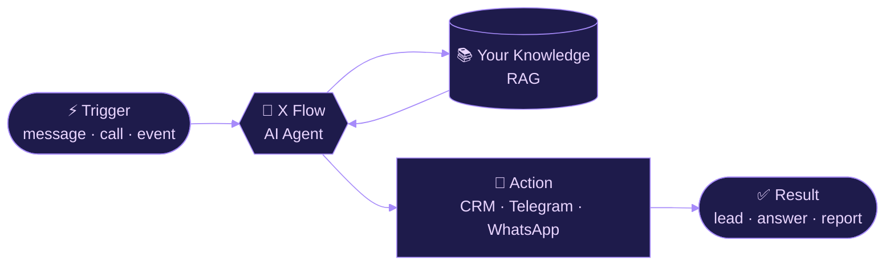

 

  

 

## ✨ &nbsp;About X Flow

**X Flow** یک پلتفرم نیتیو هوش مصنوعی است که به کسب‌وکارها کمک می‌کند **ایجنت‌های هوشمند** برای فروش، تولید محتوا، سئو، پاسخ‌گویی صوتی و پشتیبانی را در **کمتر از ۲۴ ساعت** راه‌اندازی کنند. بدون نیاز به دانش فنی، با تجربه‌ی فارسی روان و رابط کاملاً RTL.

> **X Flow** is an AI-native platform that lets businesses launch ready-made AI agents for sales, content, SEO, voice and support in under 24 hours — no technical knowledge required, built with a smooth Persian-first experience.

 

## 🤖 &nbsp;AI Agents

| Agent | What it does | Status |
|:--|:--|:--:|
| 🔍 **SEO Agent** | Keyword analysis, automated reports & ranking optimization | 🟢 Live |
| ✍️ **Content Agent** | SEO articles, captions & advertising campaigns | 🟢 Live |
| 💼 **Sales Agent** | Lead qualification, follow-ups & closing deals | 🟢 Live |
| 🎙️ **Voice RAG Agent** | Smart voice answering powered by your own knowledge base | 🟡 Beta |
| 🎧 **Support Agent** | 24/7 multi-channel chatbot with conversation memory | 🟢 Live |

 

## ⚙️ &nbsp;How It Works

 

## 🚀 &nbsp;Why X Flow

<table>
<tr>
<td width="33%" valign="top">

### 🔄 Workflow Automation
From trigger to action — everything runs automatically.

</td>
<td width="33%" valign="top">

### 🧹 No More Repetitive Work
Free up your team's time for what matters.

</td>
<td width="33%" valign="top">

### 🕒 24/7 AI Workforce
No breaks. No fatigue. Always on.

</td>
</tr>
<tr>
<td valign="top">

### ⚡ Fast Launch
Go live in under 24 hours.

</td>
<td valign="top">

### 🔌 Custom Integrations
CRM, inventory, Telegram, WhatsApp and more.

</td>
<td valign="top">

### 🛡️ Enterprise Architecture
Security, scalability and SLA.

</td>
</tr>
</table>

 

## 👥 &nbsp;Meet the Team

<table>
<tr>
<td align="center" width="25%">
  <a href="https://github.com/mehrdad2005">
     
    <b>Mehrdad Eslam</b>
  </a> 
  @mehrdad2005  
  
</td>
<td align="center" width="25%">
  <a href="https://github.com/foad8118">
     
    <b>Foad Hasani</b>
  </a> 
  @foad8118  
  
</td>
<td align="center" width="25%">
  <a href="https://github.com/mahdihemati">
     
    <b>Mahdi Hemati</b>
  </a> 
  @mahdihemati  
  
</td>
<td align="center" width="25%">
  <a href="https://github.com/seyedrn">
     
    <b>Ranger</b>
  </a> 
  @seyedrn  
  
</td>
</tr>
</table>

 

## 📬 &nbsp;Get in Touch

| | |
|:--|:--|
| 🌐 **Website** | [xflow.ir](https://xflow.ir/) |
| 📧 **Email** | [hello@xflow.ir](mailto:hello@xflow.ir) |
| 📍 **Address** | Gorgan Innovation Factory, 1st Floor, Unit 410, Gorgan, Iran |

 

  

